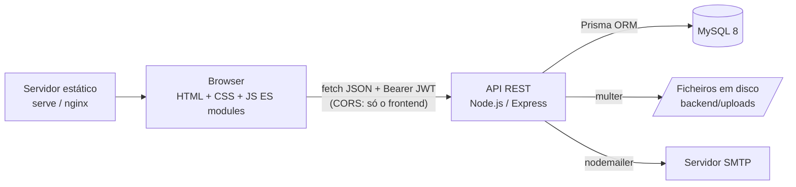
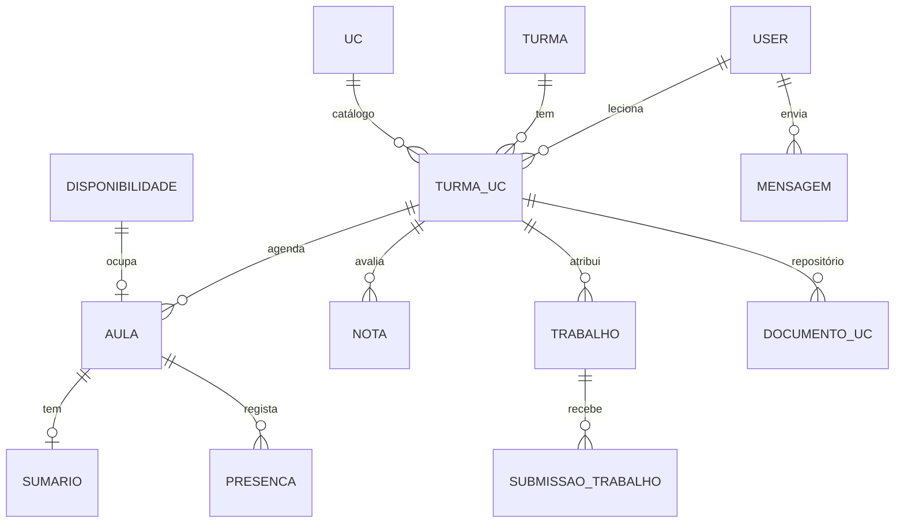

# Arquitetura — Plataforma de Gestão Pedagógica

Documento de arquitetura (UC00614 — Integração, Documentação e Deploy). Descreve como as peças se ligam; o detalhe de cada decisão, por data, está em `PLANEAMENTO.md`.

## 1. Visão geral

- **Frontend** (`src/`): páginas estáticas, sem framework nem bundler. Cada página tem o seu módulo JS (`src/js/`); `api-client.js` centraliza os pedidos (cookie de sessão, erros em PT), `guard.js` protege as páginas por papel e `menu.js` desenha o menu de cada papel.
- **Backend** (`backend/src/`): API REST em camadas — `routes` (URL, papéis, documentação OpenAPI) → `controllers` (validação com `zod`, formato da resposta) → `services` (regras de negócio, acesso à BD com Prisma). Erros de negócio são `AppError` com código estável (`{error:{code,message,statusCode}}`).
- **Base de dados**: MySQL 8, esquema em `backend/prisma/schema.prisma`, migrações versionadas em `backend/prisma/migrations/`.
- **Ficheiros**: guardados em disco (`backend/uploads/`), **nunca servidos como estáticos** — só saem por rotas autenticadas que verificam quem pode ver cada ficheiro.
- **Email**: `nodemailer`; sem SMTP configurado, em desenvolvimento, usa uma conta de teste (Ethereal) que não entrega a ninguém e imprime a pré-visualização na consola; com `SMTP_HOST` envia a sério. Em produção (`NODE_ENV=production`) sem `SMTP_HOST` o envio falha, para não mandar credenciais para o serviço de teste.

## 2. Papéis e permissões

| Papel | Pode |
|---|---|
| **Coordenador** | tudo na gestão: turmas, UCs, formadores, formandos, pedidos de acesso, agendar aulas, ver pautas/conformidade/relatórios |
| **Formador** | definir a sua disponibilidade; dar aulas nas suas UCs (presenças, notas, trabalhos, sumários, documentos); validar sumários se for **mediador** da turma |
| **Formando** | ver o seu horário, sumários validados, documentos, notas; justificar faltas; submeter trabalhos; mensagens |

O **mediador** não é um papel à parte: é um formador designado em `Turma.mediadorId`. As verificações estão em `middleware/auth.js` (`requireAuth`, `requireRole`) e em `lib/acesso.js` (responsável da UC, formando da turma).

## 3. Modelo de dados (resumo)

Convenções: apagar é **desativar** (`ativo=false`), para manter o histórico (exceção: cancelar uma aula é um `DELETE` definitivo); as notas têm histórico de alterações (`NotaHistorico`); `TurmaUc` é a ligação central (uma UC numa turma, com o seu formador) e a ela se prendem aulas, notas, trabalhos e documentos.

## 4. Funcionalidades por módulo

| Módulo | Backend (`/api/v1/...`) | Notas |
|---|---|---|
| Autenticação | `auth` | login JWT (7 dias) em cookie httpOnly, logout, perfil, recuperação de palavra-passe (token de 1 h, uso único) |
| Pedidos de acesso | `pedidos-acesso` | público (com limitador); aprovação em dois passos: a coordenação decide (fica a aguardar os RH) e, só depois de confirmar que os RH criaram a conta, a conta é criada e as credenciais enviadas por email |
| Turmas, UCs, formadores, formandos | `turmas`, `ucs`, `turma-ucs`, `formadores`, `formandos` | CRUD com soft delete; cópia de UCs entre turmas; substituição de formador |
| Agenda | `disponibilidade`, `aulas`, `calendario` | blocos de 1 h; marcação só em blocos livres; exportação `.ics` |
| Sumários | `sumarios` | formador escreve, mediador/coordenação valida (rejeição com motivo) |
| Documentos | `documentos` | upload por UC, nome oficial `IDCurso_UC_Data`, histórico |
| Conformidade | `painel/conformidade` | semáforos automáticos (sumários, documentos, horário) |
| Avaliação | `notas`, `assiduidade`, `trabalhos` | pautas em CSV/PDF; justificações de faltas com anexo |
| Comunicação | `mensagens`, notificações por email | emails sem dados sensíveis |
| Painéis e pesquisa | `painel`, `pesquisa` | resumos por papel; pesquisa global |

A documentação interativa da API está em `/api-docs` (Swagger, gerado a partir dos comentários OpenAPI das rotas).

## 5. Segurança

Passwords com `bcrypt`; JWT verificado a cada pedido (a conta tem de estar ativa e a sessão só vale enquanto a palavra-passe for a mesma com que foi iniciada); CORS limitado ao frontend; validação de entrada com `zod`; limitadores de pedidos (login, pedidos de acesso, recuperação de palavra-passe, calendário); uploads com lista de extensões e tamanho máximo; ficheiros só por rotas autenticadas; texto de utilizadores escapado no frontend (`escapeHtml`). Ver `backend/RGPD.md` para a análise de dados pessoais.

## 6. Testes

Jest + Supertest contra uma base de dados dedicada (`plataforma_pedagogica_test`, configurada em `backend/.env.test`): testes de integração por módulo (permissões, regras, casos limite) e unitários (validação, limitador). Ver `COMO_TESTAR.md`.

## 7. Deploy

A API corre com `npm start` em `backend/` (aplicar antes as migrações com `npx prisma migrate deploy`) e o frontend é servido como ficheiros estáticos (`src/`) por qualquer servidor web. Variáveis de ambiente da API:

| Variável | Para quê |
|---|---|
| `DATABASE_URL` | ligação MySQL |
| `JWT_SECRET` | segredo dos tokens (obrigatório, longo e aleatório em produção) |
| `PORT` | porta da API (4000) |
| `CORS_ORIGIN` | origem do frontend aceite pela API |
| `FRONTEND_URL` | (opcional) endereço usado nas ligações de recuperação de palavra-passe |
| `SMTP_*` | (opcional) servidor de email real |

Dados de exemplo: `npm run seed` (só numa base de dados vazia; recusa `NODE_ENV=production`).

## 8. Limitações conhecidas

- Limitadores em memória (uma instância); ficheiros em disco local (para escalar, mover para armazenamento externo).
- O endereço da API é configurável por página (`<meta name="api-origin" content="...">` ou `window.API_ORIGIN`); por omissão usa o mesmo servidor da página na porta 4000 (`src/js/api-client.js`).
- A sessão do browser é um cookie httpOnly (`pedagogica_sessao`): o JavaScript da página não a lê, por isso um XSS não a rouba. Como o cookie é enviado automaticamente, os pedidos que alteram dados exigem o cabeçalho `X-Requested-With: pedagogica` e, se houver `Origin`, que seja o de `CORS_ORIGIN`. O frontend e a API têm de estar no mesmo "site" (ex.: `localhost`, ou `app.exemplo.pt` e `api.exemplo.pt`); se não estiverem, definir `COOKIE_SAMESITE=none` (exige HTTPS).
- O formador de cada aula é o dono do bloco de disponibilidade em que ela está marcada (`Aula.disponibilidade.formadorId`): ao substituir o formador de uma UC só as aulas futuras mudam para blocos do novo formador, e horários, relatório de horas e calendário usam este formador. A responsabilidade pela UC (sumários, notas, assiduidade) continua a ser do formador atual da UC.
- Pedidos simultâneos sobre a agenda, os horários, as notas e a troca de formador são serializados com bloqueios de linha (`backend/src/lib/bloqueios.js`); "hoje" é o dia em Lisboa (`backend/src/lib/tempo.js`).
- Sem HTTPS nem refresh tokens no projeto base — ver checklist em `backend/RGPD.md` antes de produção.
